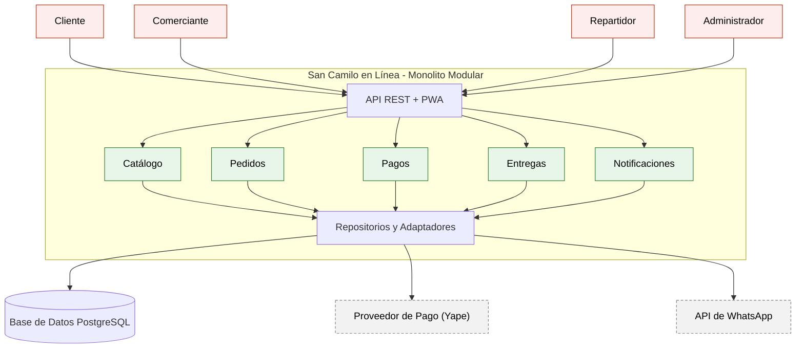

# San Camilo en Linea 

Construccion de Software - EPIS UNSA - 2026-B - Grupo 07

## Resumen 

San Camilo en Linea es una propuesta de plataforma web progresiva para conectar a clientes con los puestos del Mercado San Camilo. El MVP permitira consultar productos por puesto, armar pedidos multi-puesto, elegir recojo o delivery, registrar pagos con Yape y enviar confirmaciones por WhatsApp. La solucion esta pensada para un equipo academico de hasta tres estudiantes, un plazo de un mes y un presupuesto reducido.

La prioridad de arquitectura es la capacidad de interaccion del comerciante: una persona con poca experiencia digital debe poder publicar un producto en 3 toques o menos desde un celular de gama baja. Las decisiones se documentan con drivers, escenarios medibles y ADR para que el equipo pueda justificar tanto lo elegido como lo descartado.

## Integrantes

| Nombre | Correo institucional |
|---|---|
| Pari Charrez Dean Diego | dparich@unsa.edu.pe |
| Carfer Carpio Nagin Jazmin | ncarferc@unsa.edu.pe |
| Chirinos Rojas Kennedy | kchirinosr@unsa.edu.pe |

## Caso

San Camilo en Linea permite consultar los catalogos de los puestos del Mercado San Camilo y realizar pedidos para recojo o delivery. El cliente puede comprar productos de varios puestos y pagar con Yape. Los comerciantes administran sus productos y reciben confirmaciones por WhatsApp; los repartidores actualizan el estado de sus entregas. El atributo critico es la capacidad de interaccion: un comerciante con poca experiencia debe publicar un producto en 3 toques o menos desde un celular de gama baja.

### Actores y flujo principal

1. El comerciante registra o actualiza productos, precios y disponibilidad desde la PWA.
2. El cliente consulta el catalogo agrupado por puesto y agrega productos al carrito.
3. El cliente confirma la modalidad de recojo o delivery, registra sus datos y adjunta la referencia del pago.
4. El sistema persiste el pedido, separa los items por puesto y notifica al comerciante.
5. Cada comerciante acepta o rechaza sus items; el repartidor consulta la asignacion y actualiza el estado de entrega.
6. El administrador puede revisar incidencias y mantener los puestos, usuarios y estados excepcionales.

### Alcance y supuestos

El alcance del MVP cubre catalogo, productos, pedidos, pagos referenciados, notificaciones y entregas basicas. Se asume que la integracion con Yape se realizara mediante un proveedor o mecanismo autorizado disponible para el proyecto, y que WhatsApp se conectara mediante un servicio habilitado. No se asume que Yape ofrece una API publica abierta ni se incluyen datos personales reales en prompts o repositorios.

## Arquitectura elegida

## Decisiones arquitectonicas

- [ADR-001: Estilo arquitectonico](docs/architecture/adr/001-estilo-arquitectonico.md)
- [ADR-002: Base de datos relacional](docs/architecture/adr/002-base-de-datos-relacional.md)
- [ADR-003: Autenticacion y roles](docs/architecture/adr/003-autenticacion-y-roles.md)

## Trazabilidad y entregables

- [E1: Drivers, requisitos y escenarios de calidad](docs/architecture/drivers.md)
- [E2: Matriz de decisión](docs/architecture/matriz-decision.md)
- [E3: Código Mermaid de la arquitectura](docs/architecture/diagramas/arquitectura.mmd)
- [E4: Directorio de decisiones arquitectonicas](docs/architecture/adr/)
- [E5: Alternativa descartada en PlantUML](docs/architecture/diagramas/alternativa.puml)
- [E6: Vista de despliegue en PlantUML](docs/architecture/diagramas/despliegue.puml)
- [E7: Bitácora de uso de IA](docs/architecture/bitacora-ia.md)

E6 se documentó mediante PlantUML como alternativa de despliegue, debido a la incompatibilidad del entorno local con Graphviz y Python Diagrams. La decisión y el código fuente del diagrama quedan versionados en el repositorio.

Los drivers `RF`, `QA` y `R` se citan dentro de los ADR. QA-01 verifica la publicacion de productos; QA-02 verifica la persistencia ante fallas de WhatsApp; QA-03 verifica el rendimiento; QA-04 verifica la incorporacion de un nuevo adaptador; y QA-05 verifica la autorizacion por rol y puesto.

## Diagramas e imagenes generadas

| Entregable | Fuente | Imagen |
|---|---|---|
| Arquitectura elegida | [arquitectura.mmd](docs/architecture/diagramas/arquitectura.mmd) | [San Camilo API REST](docs/architecture/diagramas/img/San%20Camilo%20API%20REST-2026-10-04-030059.png) |
| Alternativa descartada | [alternativa.puml](docs/architecture/diagramas/alternativa.puml) | [Alternativa](docs/architecture/diagramas/img/Alternativa.png) |
| Vista de despliegue | [despliegue.puml](docs/architecture/diagramas/despliegue.puml) | [Despliegue](docs/architecture/diagramas/img/fig6.png) |
| Diagrama Mermaid embebido | [README.md](README.md#arquitectura-elegida) | Incluido en esta portada |

## Criterios de calidad

| Atributo | Objetivo verificable |
|---|---|
| Capacidad de interaccion | Publicar un producto en 3 toques o menos y 15 segundos o menos en el 90 % de 20 pruebas. |
| Disponibilidad | Perder 0 pedidos en 100 pruebas cuando WhatsApp no responde y reintentar en 15 minutos o menos. |
| Rendimiento | Mantener p95 de catalogo <= 2 segundos y p95 de carrito <= 3 segundos con 200 clientes concurrentes. |
| Modificabilidad | Agregar un adaptador de pago en 2 dias-persona o menos sin cambiar otros modulos. |
| Seguridad | Rechazar el 100 % de 30 intentos de acceso a recursos de otro puesto. |

## Reflexion sobre el uso de la IA

La IA ayudo a proponer alternativas y a convertir las necesidades del mercado en requisitos y escenarios medibles. Tambien sirvio para revisar la estructura de los ADR y detectar consecuencias que podian quedar fuera. El equipo no tomo sus sugerencias como decisiones automaticas, porque una propuesta puede ignorar el presupuesto, el plazo o la conectividad real. Verificamos que Yape y WhatsApp requieren integraciones disponibles y no asumimos capacidades no confirmadas. La arquitectura elegida prioriza una solucion operable por un equipo pequeno y deja documentados sus riesgos. Las afirmaciones tecnicas deben contrastarse con documentacion oficial, pruebas y restricciones del caso. La bitacora registra las propuestas aceptadas, corregidas y rechazadas.

## Diseno UML

### Entregables de diseno

| Entregable | Archivo(s) | Responsable | Imagen renderizada |
|---|---|---|---|
| E1 - Historia y Diagrama de Clases | [historia.md](docs/design/historia.md) / [clases.puml](docs/design/clases.puml) | Diego | [Diagrama de Clases](docs/design/img/diagrama%20de%20clases.png) |
| E2 - Diagrama de Secuencia | [secuencia-flujo.puml](docs/design/secuencia-flujo.puml) | Diego | [Diagrama de Secuencia](docs/design/img/secuencia.png) |
| E3 - Maquina de Estados | [estados-pedido.mmd](docs/design/estados-pedido.mmd) | Nagin | [Maquina de Estados](docs/design/img/Pago%20Global%20Flow%20for%20Pedido-2026-10-11-001531.png) |
| E4 - Diagrama de Actividades | [actividades-preparacion.puml](docs/design/actividades-preparacion.puml) | Nagin | [Diagrama de Actividades](docs/design/img/actividades-preparacion.png) |
| E5 - Diagrama de Paquetes | [paquetes.puml](docs/design/paquetes.puml) | Kennedy | [Diagrama de Paquetes](docs/design/img/paquetes.png) |
| E6 - Round-trip con IA | [src/pedidos/models.py](src/pedidos/models.py) / [classes_pedidos.puml](docs/design/classes_pedidos.puml) / [round-trip.md](docs/design/round-trip.md) | Kennedy | [Diagrama Invertido pyreverse](docs/design/img/classes_pedidos.png) |
| E7 - Consistencia y Bitacora | [consistencia.md](docs/design/consistencia.md) / [bitacora-ia.md](docs/design/bitacora-ia.md) | Equipo | - |
| E8 - Entrega | [README.md](README.md) / GitHub PR / tag `v0.5-diseno` | Equipo | - |

---

## Estado del trabajo

| Entregable | Responsable | Estado |
|---|---|---|
| **Laboratorio 04** | | |
| E1: drivers y escenarios | Kennedy | Completado |
| E2: alternativas y matriz | Diego | Completado |
| E3: arquitectura Mermaid | Nagin | Completado |
| E4: ADR 001, 002 y 003 | Kennedy | Completado |
| E5: alternativa PlantUML | Nagin | Completado |
| E6: despliegue | Nagin | Completado |
| E7: bitacora de IA | Diego | Completado |
| E8: README y revision cruzada | Equipo | Completado |
| **Laboratorio 05** | | |
| E1: Historia de usuario y diagrama de clases | Diego | Completado |
| E2: Diagrama de secuencia | Diego | Completado |
| E3: Maquina de estados (Mermaid) | Nagin | Completado |
| E4: Diagrama de actividades | Nagin | Completado |
| E5: Diagrama de paquetes | Kennedy | Completado |
| E6: Round-trip con IA (codigo y diferencias) | Kennedy | Completado |
| E7: Consistencia y bitacora de IA | Equipo | Completado |
| E8: Revision cruzada, README y tag final | Equipo | En proceso |
| **Laboratorio 06** | | |
| E1: Inventario y contexto en Structurizr DSL | Diego | Completado |
| E2: Contenedores y protocolos en workspace.dsl | Diego | Completado |
| E3: Componentes de la API (paquetes.puml) | Kennedy | Completado |
| E4: Vista dinamica de confirmacion y pago | Kennedy | Completado |
| E5: Despliegue en entorno Produccion | Kennedy | Completado |
| E6: Exportacion CLI, imagenes y comparacion | Nagin | Pendiente |
| E7: Revision C4, explicacion y bitacora de IA | Nagin | Pendiente |
| E8: Revision cruzada, README y tag final | Nagin | En proceso |
