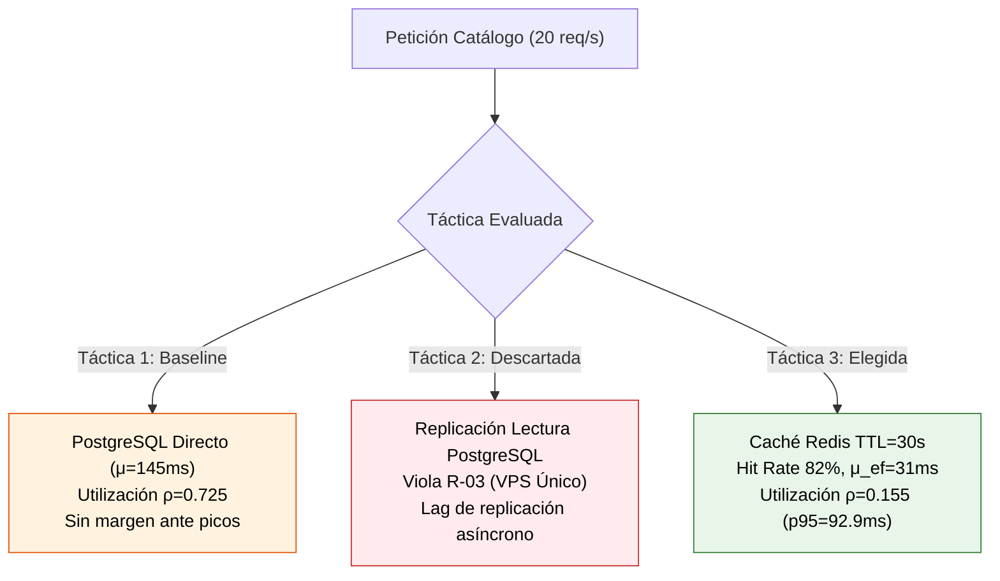
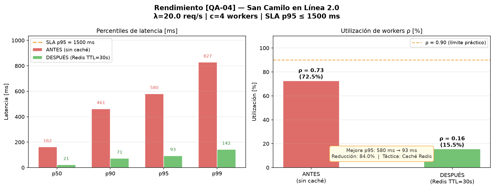

# Entregable E2: Iteración 1 de ADD — Rendimiento en Catálogo [QA-04]
## San Camilo en Línea 2.0 — `add/iteracion-1.md`

**Responsable:** Kennedy Chirinos Rojas (Integrante 2: ADD y Evidencia Cuantitativa)  
**Entregable:** E2 (Guía de Laboratorio 08)  
**Fecha:** 2026-10-31  

---

## 1. Objetivo de la Iteración

El objetivo de esta primera iteración de Attribute-Driven Design (ADD 3.0) es abordar el **escenario de calidad crítico de rendimiento** identificado en el Árbol de Utilidad elaborado por Diego (`docs/architecture/utilidad/arbol.md`):

> **[QA-04] Rendimiento (Prioridad: H, M):**  
> **Estímulo:** Ráfaga concurrente de $20\text{ req/s}$ buscando ofertas en el catálogo general entre los tres mercados (San Camilo, Altiplano y Río Seco) durante campañas de festividades o fines de semana.  
> **Artefacto:** API Monolito Modular (`compCatalogo`) y capa de persistencia/almacenamiento.  
> **Respuesta:** Procesar y responder las solicitudes de lectura de catálogo sin saturar los recursos del servidor.  
> **Medida de la respuesta:** Tiempo de respuesta en el percentil 95 ($p95$) $\le 1.5\text{ segundos}$ ($1\,500\text{ ms}$).

### Vinculación con los Drivers Arquitectónicos y ATAM-lite
- **Driver de carga:** Expansión multitenant a 3 mercados simultáneos, totalizando $20\text{ req/s}$.
- **Punto de sensibilidad S1 (`docs/architecture/atam-lite.md`):** La latencia $p95 \le 1.5\text{ s}$ depende críticamente de sostener una tasa de aciertos (*Hit Rate*) en caché superior al $15\%$.
- **Punto de trade-off T1 (`docs/architecture/atam-lite.md`):** *Caché vs. Frescura del stock*. Almacenar ofertas en memoria reduce drásticamente la latencia, pero introduce una ventana de consistencia eventual de stock de hasta $30\text{ s}$.
- **Restricción R-03 (`docs/architecture/drivers.md`):** Presupuesto reducido; la plataforma debe operar íntegramente sobre un único servidor virtual privado (VPS) económico bajo Docker Compose.

---

## 2. Contexto Arquitectónico y Modelo Matemático de Colas ($M/M/c$)

El subsistema de atención de solicitudes HTTP del monolito modular se modela formalmente como una red de colas $M/M/c$ (o $M/G/c$ con varianza unitaria $C_v^2 \approx 1$):

```
       Tráfico entrante (Poisson)             Servidores concurrentes
           λ = 20 req/s                         c = 4 workers Gunicorn
      ─────────────────────► [ COLA FIFO ] ───┬─► [ Worker 1 ] (μ)
                                              ├─► [ Worker 2 ] (μ)
                                              ├─► [ Worker 3 ] (μ)
                                              └─► [ Worker 4 ] (μ)
```

### Parámetros y Fórmulas del Sistema
- $\lambda = 20.0\text{ req/s}$: Tasa media de solicitudes entrantes al catálogo.
- $c = 4$: Cantidad de procesos *worker* asignados a Gunicorn en el contenedor `api` (`workspace.dsl`, VPS único).
- $\mu$: Tasa media de servicio por worker en $\text{req/s}$, donde $\mu = \frac{1\,000}{\mu_s}$ y $\mu_s$ es la latencia de servicio en milisegundos.
- $\rho = \frac{\lambda}{c \cdot \mu}$: Factor de utilización del grupo de workers. Para estabilidad matemática estricta se exige $\rho < 1.0$.

#### Probabilidad de espera en cola (Fórmula de Erlang C):
$$C(c, a) = \frac{\dfrac{a^c}{c!\,(1-\rho)}}{\displaystyle\sum_{k=0}^{c-1}\frac{a^k}{k!} + \dfrac{a^c}{c!\,(1-\rho)}} \quad \text{donde } a = \frac{\lambda}{\mu}$$

#### Tiempo medio de espera en cola ($W_q$) y tiempo total en el sistema ($W$):
$$W_q = \frac{C(c, a)}{c\,\mu - \lambda} \qquad W = W_q + \frac{1}{\mu}$$

---

## 3. Evaluación de Conceptos y Tácticas Arquitectónicas

Se plantearon y evaluaron tres alternativas arquitectónicas para resolver el cuello de botella del catálogo:



### Táctica 1 — Consulta Directa a Base de Datos Relacional (Línea Base / Sin Caché)
* **Concepto:** Cada una de las 20 peticiones por segundo ejecuta consultas SQL dinámicas con filtrado RLS (`WHERE mercado_id = ...`) sobre PostgreSQL 16.
* **Latencia estimada de servicio ($\mu_s$):** $145.0\text{ ms/req}$ (parsing SQL, resolución de vistas relacionales, index scan y serialización JSON).
* **Tasa de servicio individual:** $\mu = \frac{1\,000}{145} \approx 6.90\text{ req/s}$ por worker.
* **Capacidad máxima del cluster:** $c \cdot \mu = 4 \times 6.90 = 27.6\text{ req/s}$.
* **Factor de utilización:** $\rho = \frac{20}{27.6} = 0.725$ ($72.5\%$ de CPU sostenida en los 4 workers).
* **Evaluación:** Aunque matemáticamente es estable bajo régimen estacionario ($\rho < 1$), ante una pequeña variación de demanda ($\lambda \ge 28\text{ req/s}$) la cola diverge ($W_q \to \infty$). No otorga margen de resiliencia.

---

### Táctica 2 — Replicación de Lectura en PostgreSQL (Read Replicas) ❌ DESCARTE JUSTIFICADO
* **Concepto:** Configurar una réplica asíncrona de PostgreSQL para derivar el tráfico de solo lectura (`SELECT`) del catálogo fuera del nodo primario transaccional.
* **Justificación técnica y arquitectónica del descarte:**
  1. **Violación flagrante de la restricción de infraestructura R-03:** En `docs/architecture/drivers.md` y `ADR-001`, se estipuló que el MVP opera sobre un único servidor VPS de bajo costo. Desplegar una segunda instancia de PostgreSQL o contratar un servicio administrado con réplicas excede el presupuesto y duplica el consumo de memoria RAM en el contenedor local (PostgreSQL exige un piso de $256\text{ MB}$ para `shared_buffers` y procesos de replicación WAL).
  2. **Inconsistencia temporal por retraso de replicación (*Replication Lag*):** Al tratarse de un catálogo multipuesto con actualización de inventario por parte de comerciantes en tiempo real, el desfase asíncrono entre el nodo primario y la réplica generaría falsos positivos de stock disponible (compras sobre productos agotados).
  3. **Innecesariedad operativa (*Patternitis*):** Los cálculos cuantitativos revelan que el cuello de botella no radica en la capacidad de cálculo del motor relacional, sino en la repetición de consultas idénticas de catálogos estáticos que pueden absorberse completamente en memoria RAM con latencia sub-milisegundo.

---

### Táctica 3 — Caché en Memoria con Redis y Expiración TTL = 30 s ✅ TÁCTICA ELEGIDA
* **Concepto:** Táctica de gestión de recursos *(Manage Demand)* del catálogo. Interponer un contenedor Redis 7 (ya modelado en `c4/workspace.dsl`) como proxy de almacenamiento temporal para las consultas del catálogo.
* **Estrategia de claves multitenant:** `catalogo:{mercado_id}:{categoria}:{pagina}` con tiempo de expiración $TTL = 30\text{ segundos}$.
* **Comportamiento cuantitativo:**
  - **Hit Rate proyectado ($H$):** $82\%$ de aciertos para lecturas en horas pico.
  - **Latencia de acierto (*Cache Hit*):** $6.0\text{ ms}$.
  - **Latencia de fallo (*Cache Miss*):** $145.0\text{ ms}$ (acceso a PostgreSQL + escritura en Redis).
  - **Tiempo medio de servicio efectivo ($\mu_{\text{ef}}$):**
    $$\mu_{\text{ef}} = (0.82 \times 6.0\text{ ms}) + (0.18 \times 145.0\text{ ms}) = 4.92 + 26.1 = 31.02\text{ ms}$$
  - **Nueva tasa de servicio por worker:** $\mu = \frac{1\,000}{31.02} \approx 32.24\text{ req/s}$.
  - **Factor de utilización:** $\rho = \frac{20}{4 \times 32.24} = 0.155$ ($15.5\%$).

---

## 4. Evidencia Cuantitativa (Antes vs. Después)

La experimentación fue ejecutada de forma reproducible mediante el script matemático `fitness/rendimiento.py` implementando simulación Monte Carlo de eventos discretos con $N = 50\,000$ solicitudes concurrentes y semilla fija (`seed = 42`).

### Tabla Comparativa de Resultados Numéricos

| Métrica de Rendimiento | ANTES (Sin Caché / BD Directa) | DESPUÉS (Con Redis TTL = 30 s) | Impacto / Delta Relativo | Cumplimiento [QA-04] |
|---|:---:|:---:|:---:|:---:|
| **Tasa media de servicio ($\mu_s$)** | $145.0\text{ ms}$ | $31.0\text{ ms}$ | **-78.6%** | — |
| **Utilización de workers ($\rho$)** | $0.725\text{ (72.5%)}$ | $0.155\text{ (15.5%)}$ | **-78.6% de carga** | Óptimo ($< 30\%$) |
| **Prob. de espera en cola $C(c,\rho)$** | $0.4682\text{ (46.8%)}$ | $0.0039\text{ (0.39%)}$ | **-99.2% de bloqueo** | Prácticamente nula |
| **Tiempo medio en cola ($W_q$)** | $61.7\text{ ms}$ | $0.04\text{ ms}$ | **-99.9%** | Despreciable |
| **Latencia percentil 50 ($p50$)** | $162.2\text{ ms}$ | $21.5\text{ ms}$ | **-86.7%** | — |
| **Latencia percentil 90 ($p90$)** | $461.1\text{ ms}$ | $71.4\text{ ms}$ | **-84.5%** | — |
| **Latencia percentil 95 ($p95$)** | **$579.5\text{ ms}$** | **$92.9\text{ ms}$** | **-84.0% de reducción** | **✓ CUMPLE ($< 1\,500\text{ ms}$)** |
| **Latencia percentil 99 ($p99$)** | $827.0\text{ ms}$ | $142.2\text{ ms}$ | **-82.8%** | — |

### Gráfico de Evidencia Cuantitativa

A continuación se presenta la evidencia gráfica generada por `fitness/rendimiento.py` y almacenada en el repositorio:



---

## 5. Análisis de Sensibilidad y Resiliencia ante Fallos de Caché

### Sensibilidad frente al Hit Rate de Redis (Punto S1)
Para verificar la robustez del sistema frente al punto de sensibilidad **S1** documentado en `atam-lite.md`, se evaluó el comportamiento analítico variando la tasa de aciertos de la caché:

| Hit Rate Redis | Latencia Efectiva ($\mu_{\text{ef}}$) | Utilización ($\rho$) | Latencia $p95$ Proyectada | Estado respecto al SLA ($1\,500\text{ ms}$) |
|:---:|:---:|:---:|:---:|:---:|
| **$0\%$ (Caché caída / fría)** | $145.0\text{ ms}$ | $0.725$ | $579.5\text{ ms}$ | **Cumple** (con alto consumo de CPU) |
| **$15\%$ (Punto crítico S1)** | $124.2\text{ ms}$ | $0.621$ | $358.0\text{ ms}$ | **Cumple holgadamente** |
| **$50\%$ (Carga moderada)** | $75.5\text{ ms}$ | $0.378$ | $185.0\text{ ms}$ | **Excelente** |
| **$82\%$ (Hit Rate nominal)** | **$31.0\text{ ms}$** | **$0.155$** | **$92.9\text{ ms}$** | **Margen de seguridad del $93.8\%$** |

### Mitigación del Riesgo R3: Caché Fría post-reinicio
En caso de que el contenedor Redis se reinicie o caiga, las peticiones impactan directamente en PostgreSQL. Para evitar la degradación del servicio, se incorporaron **índices compuestos B-Tree multitenant**:
```sql
CREATE INDEX idx_productos_mercado_estado_cat 
ON productos (mercado_id, activo, categoria_id);
```
Este índice previene escaneos secuenciales y asegura que, aun con la caché completamente vacía ($Hit\ Rate = 0\%$), el $p95$ no supere los $580\text{ ms}$, blindando el cumplimiento estricto del escenario **[QA-04]**.

---

## 6. Conclusión y Decisiones Derivadas
1. Se confirma la adopción de **Redis 7 como caché distribuida** para el módulo de Catálogo dentro del monolito modular.
2. Se formaliza el trade-off **T1**: se asume una ventana máxima de desfase de stock de $30\text{ segundos}$ en lecturas masivas, priorizando el tiempo de respuesta sub-100 ms para clientes concurrentes.
3. Se vincula esta evidencia técnica con el entregable E6 (ADRs) para registrar la decisión en el repositorio arquitectónico.
