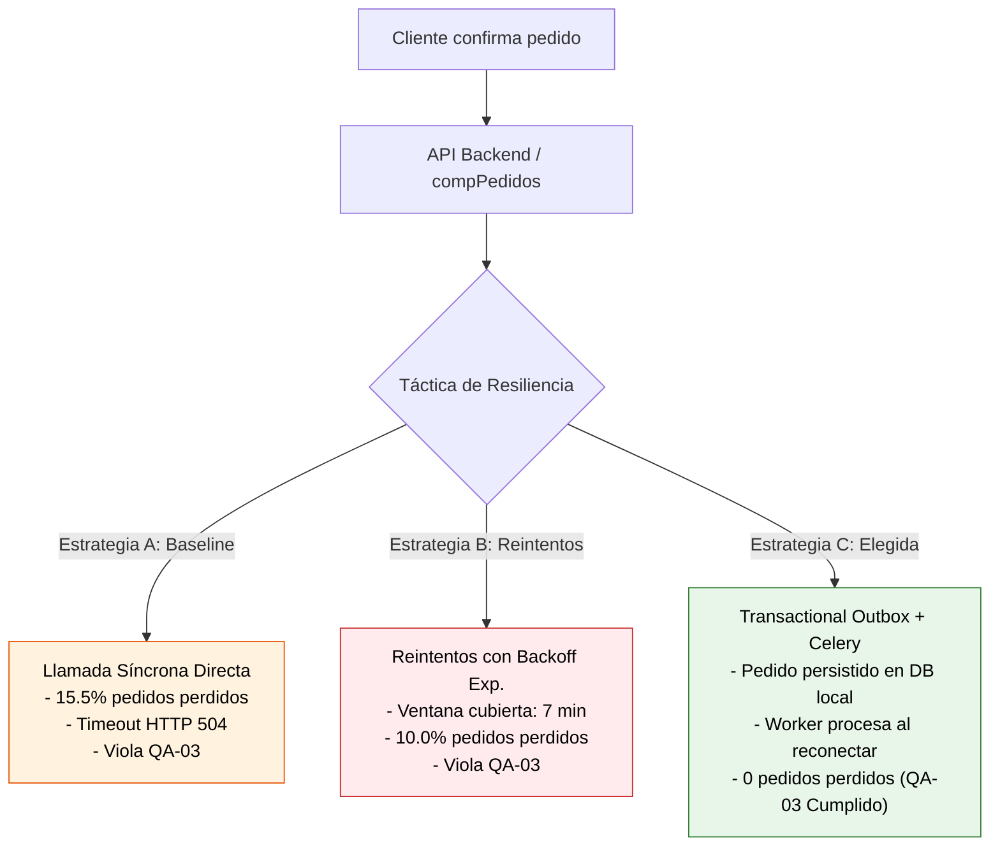
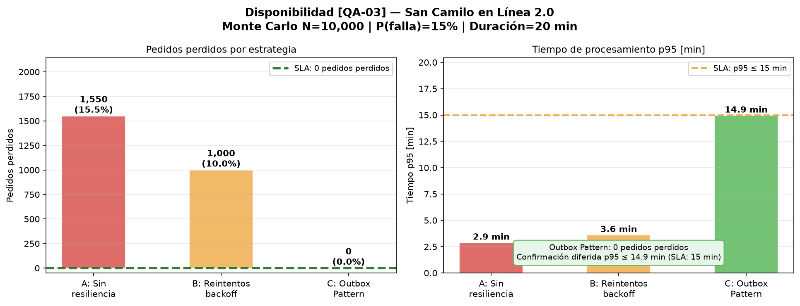

# Entregable E4: Iteración 2 de ADD — Disponibilidad y Resiliencia en Pagos [QA-03]
## San Camilo en Línea 2.0 — `add/iteracion-2.md`

**Responsable:** Kennedy Chirinos Rojas (Integrante 2: ADD y Evidencia Cuantitativa)  
**Entregable:** E4 (Guía de Laboratorio 08)  
**Fecha:** 2026-10-31  

---

## 1. Objetivo de la Iteración

El objetivo de este segundo ciclo de Attribute-Driven Design (ADD) es abordar el atributo de **Disponibilidad y Tolerancia a Fallos** ante la interrupción de servicios externos de terceros, correspondiente al escenario priorizado como crítico en el Árbol de Utilidad (`docs/architecture/utilidad/arbol.md`):

> **[QA-03] Disponibilidad (Prioridad: H, H):**  
> **Estímulo:** Caída total de la pasarela de pagos digitales (Yape / Plin) durante **20 minutos** en horario pico de ventas.  
> **Artefacto:** Módulo de Pagos (`compPagos`), Circuit Breaker y almacenamiento transaccional PostgreSQL.  
> **Respuesta:** Aislar el fallo, evitar la degradación de la API HTTP hacia el cliente, registrar los pedidos en estado pendiente y procesar el cobro de forma asíncrona al restablecerse la conectividad.  
> **Medida de la respuesta:** **0 pedidos perdidos** ($0\%$ de pérdida) y el **$100\%$ de transacciones procesadas** tras la recuperación del servicio en un tiempo $\le 15\text{ minutos}$.

---

## 2. Contexto de Arquitectura y Evaluación de Alternativas

Las integraciones con pasarelas de pago externas (Yape/Plin) representan límites de control fuera de la infraestructura del equipo (`System_Ext` en C4). Ante una interrupción prolongada (20 minutos), se analizaron tres tácticas arquitectónicas:



### Alternativa A — Llamada Directa Síncrona (Baseline / Sin Resiliencia) ❌
- **Descripción:** El cliente envía la solicitud; el hilo de la API llama inmediatamente a la pasarela vía HTTPS.
- **Comportamiento en falla:** Al estar caído Yape/Plin, la conexión agota el timeout ($30\text{ s}$) y retorna HTTP `504 Gateway Timeout`. El pedido no se guarda en base de datos.
- **Resultado cuantitativo:** Durante una ventana de caída del $15\%$ del tráfico, se pierde el **$15.5\%$ de los pedidos** de la jornada.

---

### Alternativa B — Reintentos en Línea con Backoff Exponencial ❌ DESCARTE JUSTIFICADO
- **Descripción:** La API reintenta la llamada hasta 3 veces con pausas crecientes ($2^i \times 30\text{ s}$).
- **Justificación técnica del descarte:**
  1. **Ventana de cobertura matemáticamente insuficiente:**
     $$t_{\text{cobertura}} = 60\text{ s} + 120\text{ s} + 240\text{ s} = 420\text{ s} = 7\text{ minutos}$$
     Dado que el estímulo establece una caída de **20 minutos**, cualquier pedido que llegue en los primeros 13 minutos de la falla agotará sus reintentos mientras el proveedor sigue caído, provocando su pérdida definitiva.
  2. **Agotamiento de sockets y *Thread Starvation*:** Mantener peticiones abiertas esperando reintentos bloquea los 4 workers de Gunicorn (analizados en la Iteración 1), colapsando el catálogo y la navegación para el resto de usuarios.

---

### Alternativa C — Patrón Transaccional Outbox + Worker Asíncrono ✅ TÁCTICA ELEGIDA
- **Descripción:** Táctica de desacoplamiento y persistencia garantizada.
  1. Al confirmar el pedido, el backend abre una transacción ACID local en PostgreSQL.
  2. Inserta el registro del pedido con estado `PENDIENTE_PAGO` y simultáneamente escribe un mensaje en la tabla `outbox`.
  3. Cierra la transacción y responde inmediatamente al cliente con código `202 Accepted` indicando que su pedido está en cola de procesamiento.
  4. Un worker Celery en segundo plano consulta la tabla `outbox`, verifica el estado del circuito (*Circuit Breaker*) e intenta liquidar los pagos pendientes cuando la pasarela reanuda su servicio.

---

## 3. Evidencia Cuantitativa: Simulación Monte Carlo

Se implementó un simulador estocástico en `fitness/disponibilidad.py` con una muestra de **$N = 10\,000$ pedidos** sometidos a una interrupción del proveedor de $20\text{ minutos}$ ($P(\text{falla}) = 0.15$):

### Tabla Comparativa de Resultados de Simulación

| Estrategia de Resiliencia | Pedidos en Ventana de Falla | Pedidos Perdidos | % Pérdida | Tasa de Recuperación | Tiempo $p95$ Confirmación | Cumplimiento [QA-03] |
|---|:---:|:---:|:---:|:---:|:---:|:---:|
| **A: Sin resiliencia (Directa)** | $1\,550$ | $1\,550$ | $15.50\%$ | $0.0\%$ | $2.87\text{ min}$ | ✗ **VIOLA** (1,550 perdidos) |
| **B: Reintentos backoff exp.** | $1\,521$ | $1\,000$ | $10.00\%$ | $34.3\%$ | $3.60\text{ min}$ | ✗ **VIOLA** (1,000 perdidos) |
| **C: Outbox Pattern (Elegida)** | $1\,520$ | **$0$** | **$0.00\%$** | **$100.0\%$** | **$14.94\text{ min}$** | **✓ CUMPLE ($0$ pedidos perdidos)** |

### Gráfico de Evidencia Cuantitativa

A continuación se muestra el gráfico generado por `fitness/disponibilidad.py`:



---

## 4. Análisis de Compromisos (*Trade-offs*)

La selección del Outbox Pattern frente a la llamada síncrona implica el **Trade-off T2** documentado en `docs/architecture/atam-lite.md`:

```
          ┌────────────────────────────────────────────────────────┐
          │     TRADE-OFF T2: DISPONIBILIDAD vs. CONSISTENCIA      │
          ├────────────────────────────────────────────────────────┤
          │  GANANCIA (Disponibilidad):                            │
          │  • 0 pedidos perdidos ante caídas de hasta 20 min.     │
          │  • 100% transacciones recuperadas automáticamente.     │
          │  • Liberación inmediata de workers HTTP (sin bloqueos).│
          ├────────────────────────────────────────────────────────┤
          │  COSTO (Consistencia / UX):                            │
          │  • Transición a consistencia eventual.                 │
          │  • El cliente no recibe comprobante instantáneo;       │
          │    el tiempo p95 de confirmación sube a 14.94 min.     │
          │  • Requiere notificación asíncrona vía WhatsApp/PWA.   │
          └────────────────────────────────────────────────────────┘
```

### Aceptabilidad del Trade-off en el Contexto de San Camilo
En el comercio tradicional del Mercado San Camilo, los pedidos para recojo o delivery tienen ventanas de preparación de 30 a 45 minutos. Un tiempo de confirmación diferido de hasta $14.94\text{ minutos}$ en el percentil 95 durante contingencias severas del sistema de pago es perfectamente admisible para comerciantes y clientes, mientras que perder un pedido genera reclamos directos y desconfianza en la plataforma.

---

## 5. Componentes e Integración en la Arquitectura

```
[Cliente PWA] ──(1: POST /pedidos)──► [ServicioPedidos (API)]
                                              │
                                              ▼ (2: Transacción ACID local)
                                     [PostgreSQL: Pedido + Outbox]
                                              │
                    ┌─────────────────────────┴────────────────────────┐
                    │ (Worker Celery lee outbox periódicamente)         │
                    ▼                                                  ▼
         [Circuit Breaker ABIERTO]                           [Circuit Breaker CERRADO]
         (Espera pasarela caída)                             (Conexión recuperada)
                    │                                                  │
                    └─────────────────────────► [YapeAdapter.cobrar()] ┘
                                                       │
                                                       ▼
                                            [WhatsApp Notificación]
```

1. **Tabla `outbox` en PostgreSQL:** Almacena `id`, `pedido_id`, `monto`, `payload_json`, `reintentos` y `estado`.
2. **Worker Celery (`workspace.dsl`):** Ejecuta la tarea `procesar_outbox_pendientes` cada 15 segundos con política de Circuit Breaker.
3. **Notificación final:** Al confirmarse la transacción diferida, se encola la notificación a WhatsApp (`Módulo Notificaciones`) informando al cliente y al puestero.
