# Entregable E4: Iteración 3 de ADD — Modificabilidad y Aislamiento Multitenant [QA-01, QA-02]
## San Camilo en Línea 2.0 — `add/iteracion-3.md`

**Responsable:** Kennedy Chirinos Rojas (Integrante 2: ADD y Evidencia Cuantitativa)  
**Entregable:** E4 (Guía de Laboratorio 08)  
**Fecha:** 2026-10-31  

---

## 1. Objetivo de la Iteración

El objetivo de esta tercera iteración de Attribute-Driven Design (ADD) es abordar simultáneamente los atributos de **Modificabilidad y Seguridad / Aislamiento Multitenant** derivados de la expansión comercial hacia los mercados **Altiplano** y **Río Seco**, tal como se definen en el Árbol de Utilidad (`docs/architecture/utilidad/arbol.md`):

> **[QA-01] Modificabilidad (Prioridad: H, H):**  
> **Estímulo:** Solicitud del equipo administrativo para incorporar el Mercado Altiplano con reglas de comisión, horario y tarifas de reparto diferenciadas.  
> **Artefacto:** Módulo de Catálogo y Configuración de Mercados.  
> **Respuesta:** Configurar la entidad del mercado, catálogo y tarifas sin alterar el código fuente del núcleo.  
> **Medida de la respuesta:** Despliegue completado en **$\le 1\text{ día}$** con **$0$ archivos del código fuente del núcleo modificados**.

> **[QA-02] Seguridad / Aislamiento Multitenant (Prioridad: H, M):**  
> **Estímulo:** Intento malintencionado o error de consulta de un comerciante de San Camilo para ver o modificar productos o ventas del Mercado Altiplano.  
> **Artefacto:** API REST y motor de base de datos PostgreSQL con políticas RLS (*Row-Level Security*).  
> **Respuesta:** Filtrar automáticamente las consultas asignando la clave `mercado_id` extraída criptográficamente del token JWT.  
> **Medida de la respuesta:** **$0$ filtraciones de datos** entre comerciantes de distintos mercados ($0$ filas no autorizadas retornadas).

---

## 2. Contexto de Arquitectura y Evaluación de Alternativas

La transición de una arquitectura monotenant (Mercado San Camilo) a multitenant (3 mercados) plantea el dilema clásico de segregación de datos y configuración de variabilidad:

```mermaid
flowchart TD
    SUB["Petición Tenant (mercado_id)"] --> DEC{"Estrategia Multitenant"}

    DEC -->|Alternativa 1: Descartada| DBM["Base de Datos por Mercado\n- Violación de R-03 (VPS Único)\n- RAM triplicada (>1.8 GB)\n- Migraciones complejas"]
    DEC -->|Alternativa 2: Evaluada| PLUG["Arquitectura de Plugins\n- 5-7 días de implementación\n- Viola plazo R-01 (1 mes)"]
    DEC -->|Alternativa 3: Elegida| RLS["Config-Driven + RLS en PostgreSQL\n- Tabla mercados para configuración\n- RLS a nivel de motor SQL\n- 0 cambios en código núcleo\n- Despliegue <= 0.5 días"]

    classDef elegida fill:#E8F5E9,stroke:#2E7D32,color:#000
    classDef desc fill:#FFEBEE,stroke:#C62828,color:#000
    classDef eval fill:#FFF3E0,stroke:#E65100,color:#000
    class RLS elegida
    class DBM desc
    class PLUG eval
```



### Alternativa 1 — Base de Datos Física Independiente por Mercado ❌ DESCARTE JUSTIFICADO
* **Concepto:** Desplegar una instancia o base de datos PostgreSQL separada por cada mercado (`db_sancamilo`, `db_altiplano`, `db_rioseco`).
* **Justificación técnica y arquitectónica del descarte:**
  1. **Violación estricta de la restricción presupuestal R-03:** Cada instancia de PostgreSQL requiere procesos dedicados (`postmaster`, `checkpointer`, `wal writer`, `autovacuum`), consumiendo al menos $600\text{ MB}$ de RAM base. Tres bases de datos simultáneas demandarían $> 1.8\text{ GB}$ de RAM únicamente para persistencia, asfixiando los contenedores de la API, Redis y Celery en el VPS económico.
  2. **Violación de plazo (R-01) y tamaño del equipo (R-02):** Mantener esquemas sincronizados a través de tres conexiones independientes en Django (`DATABASE_ROUTERS`) multiplica por tres el esfuerzo de despliegue, rollback y gestión de copias de seguridad.
  3. **Imposibilidad de consultas globales agregadas:** Las operaciones de reportería global para la administración general requerirían transacciones distribuidas o enlaces foráneos (`postgres_fdw`), introduciendo complejidad innecesaria para el MVP.

---

### Alternativa 2 — Módulos de Plugins de Negocio por Mercado ⚠️
* **Concepto:** Crear un subsistema de extensiones dinámicas donde cada mercado implementa clases Python separadas cargadas mediante inyección de dependencias o *entry points*.
* **Evaluación:** Aunque otorga máxima flexibilidad para mercados con lógicas radicalmente distintas, las reglas entre San Camilo, Altiplano y Río Seco únicamente difieren en valores paramétricos (comisión porcentual, tarifas zonales de delivery y horarios de atención). Construir un motor de plugins insumiría entre $5$ y $7\text{ días-persona}$, excediendo el presupuesto temporal del sprint.

---

### Alternativa 3 — Multitenancy Basado en Configuración (*Config-Driven*) + RLS en PostgreSQL ✅ TÁCTICA ELEGIDA
* **Concepto:** 
  1. **Modificabilidad:** Toda la variabilidad por mercado se externaliza a la tabla relacional `mercados` y metadatos JSONB (`tarifas_delivery`, `comision_pct`, `activo`). Agregar un nuevo mercado se reduce a una sentencia SQL `INSERT`, sin modificar el código fuente de la aplicación.
  2. **Seguridad / Aislamiento:** Se activa **Row-Level Security (RLS)** nativo en PostgreSQL 16 en las tablas transaccionales (`productos`, `pedidos`, `pagos`). Un middleware extrae el `mercado_id` del token JWT verificado y ejecuta `SET LOCAL app.current_mercado_id = '<id>'`. El propio motor de base de datos restringe el acceso a nivel de fila, garantizando que ninguna consulta SQL pueda leer o escribir datos de otro mercado aun si existiera un fallo en la lógica de Django.

---

## 3. Evidencia Técnica y Cuantitativa

### A. Impacto en Modificabilidad: Código Núcleo Modificado [QA-01]

Se comparó el esfuerzo y la cantidad de artefactos alterados para incorporar el **Mercado Altiplano** entre la arquitectura tradicional previa y la arquitectura elegida:

| Métrica de Modificabilidad | Enfoque Antes (Lógica Hardcodeada) | Enfoque Después (Config-Driven + RLS) | Impacto / Reducción |
|---|:---:|:---:|:---:|
| **Archivos de código fuente modificados** | 4 archivos (`views.py`, `models.py`, `serializers.py`, `settings.py`) | **0 archivos** (solo script de datos) | **-100% de impacto en código** |
| **Líneas de código núcleo alteradas** | ~65 líneas (`if/elif mercado == ...`) | **0 líneas** | **Cumplimiento del Principio Open/Closed** |
| **Tiempo de despliegue estimado** | $2.5\text{ días-persona}$ | **$0.25\text{ días-persona}$ ($2\text{ horas}$)** | **-90% de tiempo ($\le 1\text{ día}$)** |
| **Riesgo de regresión en mercados existentes** | Alto (requiere re-testing completo) | **Nulo** (entidades aisladas en BD) | Minimizado |

### B. Impacto en Rendimiento del Motor de Base de Datos
Tal como se documentó en la respuesta técnica a la evaluación ATAM-lite (`docs/architecture/atam-lite.md`):
- El sobrecosto (*overhead*) de procesamiento que introduce la verificación de políticas RLS por cada tupla en PostgreSQL 16 indexada por `mercado_id` es de apenas un **$2.1\%$** en tiempo de CPU, completamente absorbido gracias a la estrategia de caché Redis adoptada en la Iteración 1 ($p95 = 92.9\text{ ms}$).

### C. Verificación de Seguridad y Aislamiento de Datos [QA-02]

Se diseñó la prueba automatizada de aislamiento (*Fitness Function de Seguridad*):
```python
def test_aislamiento_multitenant_rls(db_conexion):
    # 1. Sesión autenticada como Comerciante del Mercado San Camilo
    db_conexion.execute("SET LOCAL app.current_mercado_id = 'mercado_san_camilo_id'")
    
    # 2. Intento de consulta directa a todos los pedidos registrados en el sistema
    pedidos_visibles = db_conexion.execute("SELECT puesto_id, mercado_id FROM pedidos").fetchall()
    
    # 3. Verificación de aislamiento estricto (0 filtraciones)
    mercados_obtenidos = {p.mercado_id for p in pedidos_visibles}
    assert mercados_obtenidos == {'mercado_san_camilo_id'}
    assert 'mercado_altiplano_id' not in mercados_obtenidos
    assert 'mercado_rio_seco_id' not in mercados_obtenidos
```
**Resultado:** **$100\%$ de consultas aisladas exitosamente** ($0$ filas cruzadas retornadas en todas las ejecuciones).

---

## 4. Análisis de Trade-offs y Sensibilidades

```
          ┌────────────────────────────────────────────────────────┐
          │     TRADE-OFF T3: MODIFICABILIDAD vs. COMPLEJIDAD RLS  │
          ├────────────────────────────────────────────────────────┤
          │  GANANCIA:                                             │
          │  • Alta modificabilidad: nuevos mercados en minutos.   │
          │  • Aislamiento garantizado a nivel de base de datos.   │
          │  • Cumplimiento total de R-03 (un solo PostgreSQL).    │
          ├────────────────────────────────────────────────────────┤
          │  RIESGO / SENSIBILIDAD ASOCIADA:                       │
          │  • Punto S2: Dependencia crítica de la inyección del   │
          │    mercado_id desde el JWT en el middleware.           │
          │  • Riesgo R1: Olvidar habilitar RLS en tablas nuevas   │
          │    podría exponer datos compartidos.                   │
          └────────────────────────────────────────────────────────┘
```

### Estrategia de Mitigación del Riesgo R1
Para mitigar el riesgo **R1** documentado en `atam-lite.md` (*Configuración RLS defectuosa*), se estableció una regla de control en CI/CD:
- Toda nueva migración de PostgreSQL en `src/` que cree tablas debe contener obligatoriamente la instrucción `ALTER TABLE <tabla> ENABLE ROW LEVEL SECURITY;`. Una prueba unitaria en CI inspecciona el catálogo `pg_tables` para fallar el pipeline si alguna tabla carece de esta directiva.

---

## 5. Conclusión General de las Iteraciones de ADD

Con la finalización de los tres ciclos de Attribute-Driven Design:
1. **Iteración 1 (`add/iteracion-1.md` - E2):** Se resolvió el **Rendimiento [QA-04]** mediante caché Redis TTL = 30 s, reduciendo el $p95$ de $579.5\text{ ms}$ a $92.9\text{ ms}$ (reducción del $84\%$).
2. **Iteración 2 (`add/iteracion-2.md` - E4):** Se blindó la **Disponibilidad [QA-03]** ante caídas de pasarelas de pago mediante el *Transactional Outbox Pattern*, garantizando $0$ pedidos perdidos ($100\%$ recuperados).
3. **Iteración 3 (`add/iteracion-3.md` - E4):** Se sustentó la **Modificabilidad [QA-01]** y el **Aislamiento Multitenant [QA-02]** con *Config-Driven Multitenancy* y políticas RLS nativas, permitiendo sumar mercados en $\le 0.25\text{ días}$ sin tocar el código fuente del núcleo.
