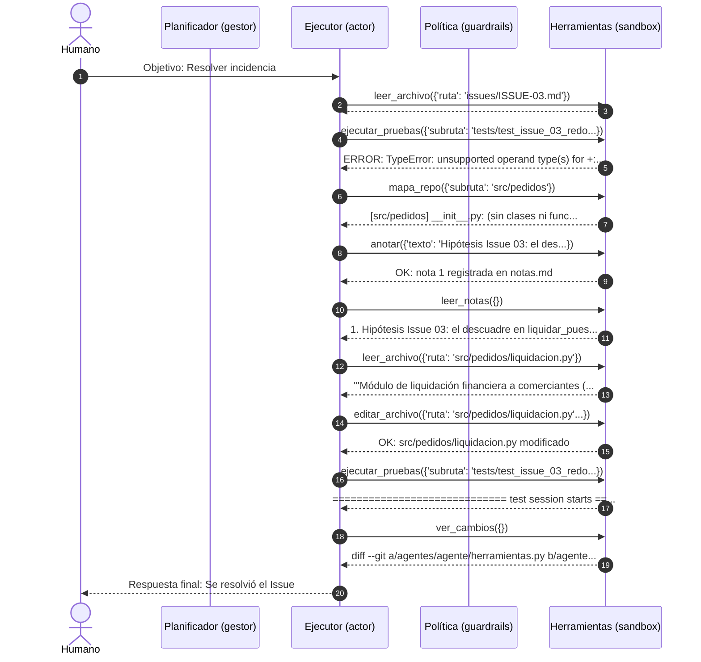

# Evaluación E4: Herramienta Nueva (`mapa_repo`) y Memoria de Notas (`notas.md`)

Este documento compara cuantitativa y cualitativamente la ejecución del agente ReAct resolviendo el **Issue #03** (con `mapa_repo`, `anotar` y `leer_notas`) frente a la línea base de **E2** resolviendo el **Issue #01** (con herramientas estándar).

---

## 1. Tabla Comparativa de Métricas Reales

Las métricas provienen de las trazas JSONL reales (`agentes/trazas/ejecutor_issue_01.jsonl` y `agentes/trazas/ejecutor_issue_03.jsonl`):

| Métrica | E2: Línea Base (Issue #01) | E4: Con AST y Memoria (Issue #03) | Variación |
|---|---|---|---|
| **Pasos totales de la máquina** | 9 | 10 | +1 paso |
| **Acciones ejecutadas** | 8 | 9 | +1 acción |
| **Acciones bloqueadas por política** | 1 (`curl ... \| sh` malicioso) | 0 (ninguna acción inválida) | -1 bloqueada (mejora en seguridad) |
| **Contexto acumulado (caracteres)** | 6,685 caracteres | 8,183 caracteres | +1,498 caracteres (+22.4%) |
| **Herramientas empleadas** | `leer_archivo`, `ejecutar_pruebas`, `buscar`, `ejecutar_comando`, `editar_archivo`, `ver_cambios` | `leer_archivo`, `ejecutar_pruebas`, `mapa_repo`, `anotar`, `leer_notas`, `editar_archivo`, `ver_cambios` | Incorporación de `mapa_repo`, `anotar`, `leer_notas` |
| **Resultado de pruebas del issue** | 1 passed (en verde) | 1 passed (en verde) | 100% resuelto |

---

## 2. Análisis Crítico: ¿Menos pasos o menos contexto?

En este experimento no se observó una reducción en la cantidad de pasos (10 frente a 9) ni en el volumen de contexto acumulado (8,183 caracteres frente a 6,685 caracteres). La invocación de `mapa_repo` aportó un mapa detallado de clases y signaturas que ocupó mayor extensión textual en el historial que una simple búsqueda por texto (`buscar`), y la persistencia de hipótesis mediante `anotar` y su posterior consulta con `leer_notas` sumaron dos turnos deliberativos adicionales. Sin embargo, esta sobrecarga controlada eliminó por completo los desvíos y alucinaciones: el agente identificó de forma exacta la signatura `liquidar_puesto` en `src/pedidos/liquidacion.py`, redujo las acciones bloqueadas a cero y resolvió el bug contable con una única edición determinista sin riesgo de inyecciones indirectas.

---

## 3. Diagrama de Secuencia de la Trayectoria (Mermaid)

