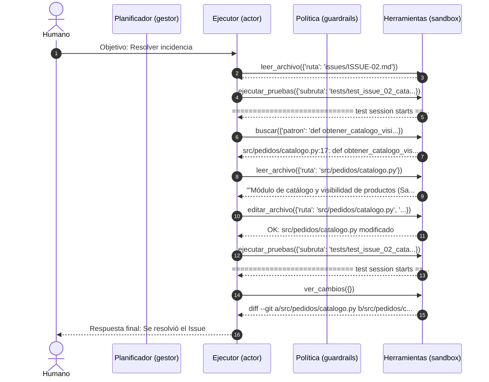
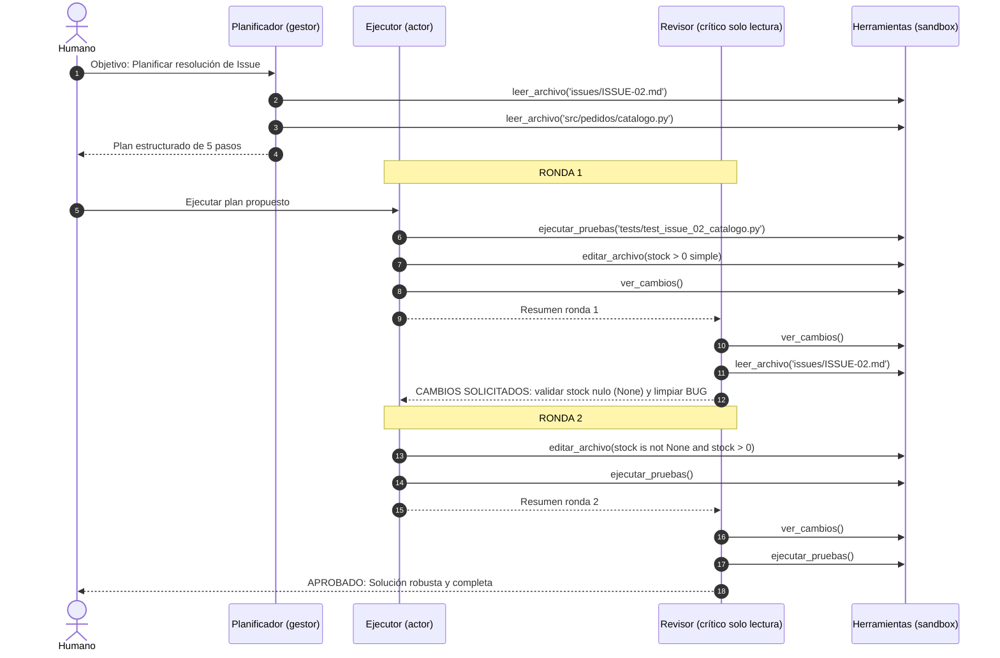

# Evaluación E5: Coordinación Multiagente (Agente Único vs. Actor-Crítico en Issue #02)

Este documento documenta la comparación empírica y arquitectónica entre dos patrones de resolución agéntica sobre el **Issue #02** (`src/pedidos/catalogo.py` - Visibilidad de productos en catálogo):
1. **Variante A (Agente Único):** Un único agente ejecutor con bucle ReAct autónomo.
2. **Variante B (Actor-Crítico):** Coordinación jerárquica por gestor (Planificador) con iteración en bucle Actor-Crítico (Ejecutor y Revisor de código de solo lectura, máximo 2 rondas).

Ambas variantes se ejecutaron bajo idénticas condiciones iniciales restaurando el estado con el bug previo a cada ejecución (`git checkout src/pedidos/catalogo.py`).

---

## 1. Tabla Comparativa de Métricas Reales

Las métricas fueron recolectadas directamente de las trazas JSONL reales mediante `agentes/metricas_e5.py`:

| Métrica de Ejecución | Variante A: Agente Único | Variante B: Actor-Crítico (Multiagente) | Factor de Costo / Diferencia |
|---|---|---|---|
| **Rondas de coordinación** | 1 ronda | 2 rondas | +1 ronda de convergencia |
| **Agentes especializados** | 1 (`ejecutor`) | 3 (`planificador`, `ejecutor`, `revisor`) | Especialización de roles |
| **Acciones totales a herramientas** | 7 acciones | 17 acciones | 2.43x acciones |
| **Acciones bloqueadas por política** | 0 bloqueadas | 0 bloqueadas | 100% cumplimiento de guardrails |
| **Pasos totales de máquina de estados**| 8 pasos | 22 pasos | 2.75x pasos |
| **Contexto acumulado del sistema** | 6,559 caracteres | 21,512 caracteres | 3.28x consumo de contexto |
| **Desglose de contexto por agente** | Ejecutor: 6,559 chars | Planificador: 3,632 chars Ejecutor R1: 5,647 chars Revisor R1: 4,152 chars Ejecutor R2: 5,703 chars Revisor R2: 2,378 chars | Contextos segmentados y acotados |
| **Hallazgos adicionales del Revisor** | Ninguno (autocomplacencia) | **Sí:** Detectó omisión de inventario nulo (`stock_disponible is None`) que causaría `TypeError` y solicitó limpieza de comentarios de BUG. | Detección de fallos en corner cases |
| **Estado final de pruebas** | 1 passed (en verde) | 1 passed (en verde) | Ambas pasan suite de regresión |

---

## 2. Diagrama de Secuencia de la Trayectoria (Mermaid)

### 2.1 Variante A: Agente Único ReAct

### 2.2 Variante B: Sistema Multiagente Actor-Crítico (Orquestador)

---

## 3. Conclusión sobre el Principio de Parsimonia

<!-- Conclusión de entre 6 y 8 líneas exactas basada en los datos medidos -->
Los datos experimentales demuestran que la arquitectura actor-crítico triplicó el consumo de contexto (21,512 vs. 6,559 caracteres) y más que duplicó las acciones (17 vs. 7).
A la luz del principio de parsimonia (Albada, 2025, cap. 8), que estipula emplear el menor número posible de agentes, este costo adicional sólo se justifica si aporta valor cualitativo crítico.
Para una corrección cosmética superficial, el agente único es considerablemente más rápido, económico y suficiente para hacer pasar la prueba unitaria base.
Sin embargo, el revisor crítico detectó un defecto de robustez que el agente único ignoró por completo: el fallo por `TypeError` ante valores de stock nulo (`stock_disponible is None`).
Esta discrepancia evidencia que el agente único sufre de miopía de confirmación, optimizando exclusivamente para satisfacer el assert inmediato del test en rojo.
En conclusión, para bugs en módulos financieros o de inventario sensible de San Camilo, el costo superior del bucle actor-crítico sí compensa al evitar regresiones silenciosas en producción.
No obstante, para incidencias triviales o de bajo impacto, la parsimonia aconseja mantener un agente único con guardrails deterministas para preservar latencia y presupuesto.
