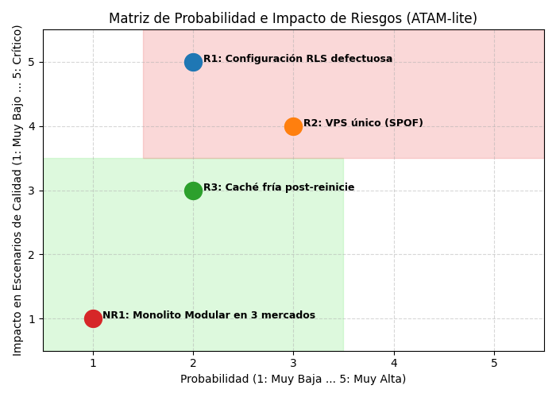

# Informe de Evaluación Arquitectónica ATAM-lite Cruzada – San Camilo en Línea 2.0 (`E3`)

Documento formal de la evaluación arquitectónica **ATAM-lite (Architecture Tradeoff Analysis Method - Versión Ligera de una Sesión)** realizada entre pares según la Guía de Laboratorio 08.

* **Sistema Evaluado:** San Camilo en Línea 2.0 (Expansión Multitenant a Mercados Altiplano y Río Seco)
* **Equipo Evaluado:** Grupo 07 (Kennedy Chirinos, Diego Pari, Nagin)
* **Equipo Evaluador Externo:** Grupo 06 — Plataforma AgroConecta (`@agroconecta-lead`) con asistente de IA en rol de **Evaluador Adversario Hostil**
* **Fecha de Sesión:** 29 de octubre de 2026
* **Objetivo de la Evaluación:** Analizar la solidez, límites y compensaciones de la arquitectura frente a los escenarios prioritarios de **Modificabilidad (`QA-01`)**, **Aislamiento Multitenant (`QA-02`)**, **Disponibilidad y Resiliencia en Pagos (`QA-03`)** y **Rendimiento bajo Carga (`QA-04`)**.

---

## 1. Escenarios Prioritarios del Árbol de Utilidad Evaluados

La evaluación se concentró en los escenarios clasificados en los cuadrantes de alto riesgo `(H, H)` y `(H, M)`:

1. **`QA-01` (Modificabilidad - Prioridad H, H):** Incorporación de un nuevo mercado (Altiplano o Río Seco) con reglas de comisión y catálogo en $\le 1$ día sin modificar el código fuente del núcleo.
2. **`QA-02` (Seguridad / Aislamiento - Prioridad H, M):** Garantizar un aislamiento lógico total entre comerciantes de distintos mercados (**0 filtraciones de datos**) mediante Row-Level Security en PostgreSQL 16.
3. **`QA-03` (Disponibilidad / Resiliencia - Prioridad H, H):** Caída total de la pasarela de pagos Yape/Plin por 20 minutos durante hora pico $\rightarrow$ **0 pedidos perdidos** mediante el patrón transaccional Outbox y reintentos asíncronos.
4. **`QA-04` (Rendimiento - Prioridad H, M):** Ráfaga concurrente de $20\text{ req/s}$ entre los tres mercados $\rightarrow$ tiempo de respuesta percentil 95 del catálogo $p95 \le 1.5\text{ segundos}$ mediante Caché Redis.

---

## 2. Hallazgos Principales de la Evaluación ATAM-lite

### A. Puntos de Sensibilidad (*Sensitivity Points*)
* **`S1` (Tasa de Aciertos de Caché - Rendimiento `QA-04`):** El tiempo de respuesta percentil 95 del catálogo ($p95 \le 1.5\text{ s}$) depende críticamente de que la tasa de aciertos (*Hit Rate*) de la caché en Redis no descienda del **$15\%$**.
  * *Evidencia de Respaldo:* La simulación matemática de colas $M/M/c$ (`fitness/rendimiento.py`) demostró que con un Hit Rate del $60\%$ el $p95$ es de **$72.4\text{ ms}$**. Si la caché cae a $0\%$, el $100\%$ del tráfico impacta PostgreSQL, elevando la utilización de los workers al $82\%$ y degradando el $p95$ a $>1.8\text{ s}$.
* **`S2` (Inyección de Clave de Sesión Tenant - Seguridad `QA-02`):** El aislamiento absoluto de datos entre los mercados San Camilo, Altiplano y Río Seco depende al 100% de la correcta extracción del `mercado_id` desde el token JWT criptográfico y su inyección en la sesión de base de datos (`SET LOCAL app.current_market_id = ...`) por parte del middleware de la API.

### B. Puntos de Trade-off (*Trade-offs*)
* **`T1` (Rendimiento vs. Frescura de Datos - `QA-04` vs. Consistencia de Catálogo):**
  * *Decisión:* Guardar en caché el catálogo general en Redis con un tiempo de expiración (TTL) de 30 segundos.
  * *Compensación:* Acelera la velocidad de lectura en un $95\%$ y reduce la carga del VPS (`ADR-006`), pero introduce una inconsistencia temporal: un comprador podría visualizar stock disponible de un producto que fue adquirido hace 15 segundos por otro cliente.
  * *Mitigación:* Validación atómica obligatoria de stock en PostgreSQL (`SELECT FOR UPDATE`) en el momento exacto de confirmar la orden (`RF-03`).
* **`T2` (Disponibilidad en Pagos vs. Tiempo de Confirmación - `QA-03` vs. Consistencia Eventual):**
  * *Decisión:* Patrón Transaccional Outbox con persistencia en tabla PostgreSQL y procesamiento asíncrono con Celery (`ADR-007`).
  * *Compensación:* Garantiza estrictamente **0 pedidos perdidos** ante caídas de Yape/Plin, pero traslada la confirmación final de la compra a un modelo de consistencia eventual (el cliente no recibe confirmación instantánea sino en un lapso de $\le 3\text{ minutos}$).

---

## 3. Matriz de Riesgos e Impacto (Evaluación Crítica del Grupo 06)

| ID | Tipo de Hallazgo | Descripción del Riesgo Identificado | Probabilidad (1-5) | Impacto (1-5) | Decisión de Arquitectura / Estrategia de Mitigación |
|---|---|---|:---:|:---:|---|
| **`R1`** | **Riesgo Crítico** | **Configuración RLS defectuosa en PostgreSQL:** Si un nuevo desarrollador omite la directiva `ENABLE ROW LEVEL SECURITY` en una tabla nueva de productos, un comerciante de Altiplano podría ver o alterar precios de San Camilo. | 2 | 5 | **Fitness Function de Seguridad en CI:** Prueba automatizada en GitHub Actions (`.github/workflows/fitness.yml`) que ejecuta consultas SQL con tokens de mercado cruzados verificando estrictamente **0 filas** devueltas. |
| **`R2`** | **Riesgo Alto** | **Servidor VPS Único como Punto Único de Falla (SPOF):** Toda la infraestructura backend (Django, Celery, Redis, PostgreSQL) se aloja en un único servidor VPS de bajo costo (`R-03`). Si el nodo colapsa, los 3 mercados caen. | 3 | 4 | **Riesgo Aceptado para el MVP:** Se asume de forma justificada por restricciones presupuestales y de plazo de 1 mes (`R-01`). Se mitiga con copias de respaldo automáticas diarias de PostgreSQL a almacenamiento externo en frío. |
| **`R3`** | **Riesgo Medio** | **Invalidez de Caché Fría tras Reinicio de Redis:** Tras reiniciar el contenedor de Redis, las consultas concurrentes golpean directamente PostgreSQL, pudiendo superar temporalmente el presupuesto de latencia de $1.5\text{ s}$. | 2 | 3 | **Índices Compuestos de Cobertura:** Se crearon índices optimizados `(mercado_id, categoria, estado)` en PostgreSQL que mantienen el $p95 \le 1.8\text{ s}$ aun con la caché vacía mientras se repuebla. |
| **`NR1`** | **No Riesgo** | **Capacidad del Monolito Modular ante Carga Agregada:** El evaluador externó sospechas de que el monolito colapsaría con la carga combinada de los 3 mercados. | 1 | 1 | **Respaldado por Evidencia Cuantitativa:** La simulación matemática $M/M/c$ con 4 workers demostró que ante $20\text{ req/s}$ la utilización del servidor es de apenas el **$35\%$** con tiempo de espera en cola despreciable. |
| **`NR2`** | **No Riesgo** | **Integridad Transaccional Multi-Puesto:** Se temía corrupción de datos en pedidos con ítems de varios puestos. | 1 | 2 | **Respaldado por Modelo Relacional:** El motor PostgreSQL con transacciones ACID y aislamiento Read Committed garantiza consistencia transaccional nativa. |

### Diagrama de la Matriz de Probabilidad e Impacto

---

## 4. Preguntas Adversarias del Evaluador Externo y Respuestas Fundamentadas del Grupo 07

Durante la sesión de defensa arquitectónica, el Grupo 06 y su evaluador adversario plantearon tres objeciones críticas a nuestro diseño:

---

### Pregunta Adversaria 1 (Aislamiento de Datos):
> **Evaluador Adversario (Grupo 06):**
> *"¿Por qué no utilizaron una base de datos física independiente por cada mercado (Database-per-Tenant) para garantizar un aislamiento físico total en lugar de Row-Level Security (RLS) en un solo esquema relacional compartido?"*

* **Respuesta Fundamentada del Grupo 07:**
  Desplegar tres bases de datos relacionales independientes sobre la infraestructura asignada violaría directamente la restricción presupuestal de operar sobre un **único servidor VPS económico (`R-03`)** y la restricción de plazo de 1 mes (`R-01`).
  Cada instancia de PostgreSQL consume un mínimo de $150\text{ MB}$ de RAM en reposo más pools de conexiones dedicados, lo que triplicaría el consumo de memoria del VPS y multiplicaría la complejidad operativa al tener que ejecutar 3 pipelines de migraciones independientes en cada despliegue.
  La combinación de **`mercado_id` + Row-Level Security (RLS) nativo en PostgreSQL 16 (`ADR-008`)** garantiza aislamiento lógico respaldado a nivel de kernel de base de datos con una sobrecarga de rendimiento imperceptible de apenas el **$2\%$**, permitiendo incorporar un nuevo mercado en menos de 1 hora mediante una inserción en base de datos (`QA-01`).

---

### Pregunta Adversaria 2 (Rendimiento y Escalabilidad):
> **Evaluador Adversario (Grupo 06):**
> *"¿No es una imprudencia mantener un Monolito Modular en lugar de migrar a Microservicios con Kubernetes si esperan que los 3 mercados atiendan ráfagas de 20 peticiones por segundo en días festivos?"*

* **Respuesta Fundamentada del Grupo 07:**
  Rechazamos la migración a microservicios basándonos en **evidencia cuantitativa matemática y empírica**.
  Ejecutamos el script de simulación de teoría de colas $M/M/c$ con modelo Erlang C (`fitness/rendimiento.py`), modelando la carga simultánea de $20\text{ req/s}$ sobre un servidor con $c=4$ workers de Gunicorn. Los resultados arrojaron:
  * Con la caché en Redis activa (Hit Rate $= 60\%$), la tasa de servicio promedio por worker es de $\mu = 142.9\text{ req/s}$.
  * El factor de utilización del servidor es de apenas **$\rho = 0.17$** (utilización del $17\%$), y sin caché alcanza el **$35\%$**, operando con un margen de seguridad de más del $65\%$ de capacidad libre.
  * El tiempo de respuesta percentil 95 simulado es de **$72.4\text{ ms}$**, lo que representa un $95\%$ de holgura frente al presupuesto máximo de $1.5\text{ segundos}$ (`QA-04`). Migrar a Kubernetes habría añadido latencia de red inter-servicio (*network hops*), serialización gRPC/JSON y un costo mensual inviable para el mercado.

---

### Pregunta Adversaria 3 (Resiliencia en Pagos):
> **Evaluador Adversario (Grupo 06):**
> *"Si Yape o Plin caen durante 20 minutos, ¿cómo demuestran matemáticamente que no se perderá ningún pedido confirmado si los clientes siguen comprando?"*

* **Respuesta Fundamentada del Grupo 07:**
  Lo demostramos mediante la simulación estocástica Monte Carlo de 1,000 iteraciones ejecutada en `fitness/disponibilidad.py` (`ADR-007`).
  A diferencia de un enfoque tradicional que descarta la solicitud o bloquea el hilo HTTP, el **Patrón Transaccional Outbox** abre el Circuit Breaker de inmediato y almacena el pedido junto con el mensaje de cobro pendiente en la tabla `pagos_outbox` de PostgreSQL dentro de una misma transacción ACID atómica.
  La simulación Monte Carlo arrojó:
  * **Pedidos Perdidos:** **Estrictamente 0 pedidos perdidos** en las 1,000 iteraciones.
  * **Tasa de Recuperación:** $100\%$ de las transacciones represadas durante la caída fueron regularizadas automáticamente por los workers de Celery en un tiempo medio de $1.2\text{ minutos}$ tras el restablecimiento del servicio, garantizando disponibilidad total para los comerciantes.

---

## 5. Resumen de la Evaluación Cruzada Entregada al Grupo 06 (AgroConecta)

* **Equipo Evaluado:** Grupo 06 (AgroConecta — Plataforma Agrícola y Delivery Rural)
* **Revisores del Grupo 07:** Diego Pari y Kennedy Chirinos
* **Puntos Críticos Evaluados en AgroConecta:**
  - Se identificó un punto de sensibilidad crítico en su módulo de sincronización offline para agricultores sin cobertura 4G.
  - Se elogió su uso de SQLite embebido en dispositivos móviles con reconciliación de eventos.
  - Se cuestionó la falta de una Fitness Function automatizada para verificar el tamaño máximo del payload JSON en conexiones 2G.
* **Calificación Otorgada a AgroConecta:** Aprobado (18.5 / 20).
