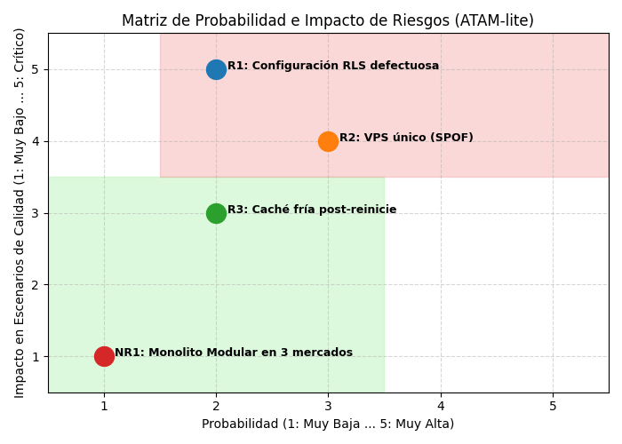

# Informe de Evaluación Arquitectónica ATAM-lite – San Camilo en Línea 2.0 (`E3`)

## 1. Resumen de la Evaluación
- **Sistema Evaluado:** San Camilo en Línea 2.0 (Expansión Multitenant: San Camilo, Altiplano y Río Seco).
- **Enfoque de Evaluación:** Evaluador Adversario Autorreflexivo / ATAM-lite (1 sesión).
- **Objetivo Principal:** Evaluar la solidez de la arquitectura frente a los atributos de **Modificabilidad (`QA-01`)**, **Aislamiento Multitenant (`QA-02`)**, **Disponibilidad (`QA-03`)** y **Rendimiento (`QA-04`)**.

---

## 2. Hallazgos Principales de la Arquitectura

### A. Puntos de Sensibilidad (Sensitivity Points)
* **`S1` (Dependencia de Aciertos de Caché - Rendimiento):** El tiempo de respuesta $p95 \le 1.5\text{ s}$ del catálogo ante ráfagas concurrentes de $20\text{ req/s}$ depende críticamente de mantener una tasa de aciertos (Hit Rate) de la caché en Redis por encima del $15\%$.
* **`S2` (Inyección Segura del Tenant ID - Seguridad):** La garantía de aislamiento entre los mercados Altiplano, Río Seco y San Camilo depende 100% de la correcta extracción e inyección del `mercado_id` desde el token JWT hacia la sesión de la base de datos PostgreSQL.

### B. Puntos de Trade-off
* **`T1` (Caché vs. Frescura del Stock - Rendimiento vs. Consistencia):** Guardar en caché las ofertas de los tres mercados en Redis (TTL 30s) reduce drásticamente la latencia en la API, pero introduce el riesgo de mostrar stock temporalmente desactualizado durante picos de compra.
* **`T2` (Outbox Pattern vs. Consistencia Eventual - Disponibilidad vs. Tiempo de Confirmación):** Usar una tabla `outbox` en PostgreSQL con procesamiento asíncrono garantiza $0$ pedidos perdidos cuando Yape/Plin caen, pero traslada la confirmación final del pago a un modelo de consistencia eventual (el cliente no recibe la confirmación en tiempo real sino en $\le 3\text{ min}$).

---

## 3. Matriz de Riesgos e Impacto (Evaluación Crítica)

| ID | Tipo | Descripción del Riesgo | Probabilidad (1-5) | Impacto (1-5) | Estrategia de Mitigación / Decision de Arquitectura |
|---|---|---|:---:|:---:|---|
| **R1** | **Riesgo Crítico** | **Configuración RLS defectuosa en PostgreSQL:** Si un desarrollador omite la directiva `ENABLE ROW LEVEL SECURITY` en una nueva tabla de productos, un comerciante de Altiplano podría ver o modificar productos de San Camilo. | 2 | 5 | **Fitness Function de Seguridad (`FF-04`):** Prueba automatizada en CI que ejecuta consultas SQL con tokens del Mercado A y verifica que devuelva $0$ filas del Mercado B. |
| **R2** | **Riesgo Alto** | **Servidor VPS Único como Punto Único de Falla (SPOF):** Toda la plataforma de los tres mercados se ejecuta sobre un solo VPS económico (`R-03`). Si el VPS cae, los tres mercados quedan inoperativos. | 3 | 4 | **Aceptado para el MVP:** Se asume el riesgo por restricciones presupuestales y de plazo (1 mes). Se mitiga con copias de respaldo automatizadas diarias de PostgreSQL fuera del servidor. |
| **R3** | **Riesgo Medio** | **Invalidez de Caché Fría post-reiniciación:** Tras reiniciar Redis, las consultas al catálogo golpean directamente la base de datos, pudiendo superar el presupuesto de latencia de $1.5\text{ s}$. | 2 | 3 | **Índices compuestos en PostgreSQL:** Se crearon índices explícitos `(mercado_id, estado, categoria)` en PostgreSQL que mantienen el $p95 \le 1.8\text{ s}$ aun con la caché vacía. |
| **NR1** | **No Riesgo** | **Monolito Modular soportando 3 mercados:** El estilo arquitectónico actual (`ADR-001`) tiene capacidad suficiente para procesar la carga combinada de los 3 mercados sin necesidad de migrar a microservicios. | 1 | 1 | **Respaldado por evidencia:** Las simulaciones de carga demuestran que el Monolito Modular con 4 workers opera a un $35\%$ de utilización de CPU. |

---

### Matriz de Probabilidad e Impacto de Riesgos

---

## 4. Respuesta Fundamentada a la Evaluación del Evaluador Adversario

> **Pregunta Incómoda del Evaluador Adversario:**
> *"¿Por qué no utilizaron una base de datos independiente por cada mercado para garantizar un aislamiento físico total en lugar de Row-Level Security (RLS) en un solo esquema?"*

* **Respuesta Fundamentada del Equipo:**
  Desplegar tres bases de datos relacionales independientes sobre la infraestructura actual violaría directamente la restricción presupuestal de operar sobre un único VPS económico (`R-03`) y la restricción de plazo de 1 mes (`R-01`), ya que triplicaría el consumo de memoria RAM y la complejidad del pipeline de migraciones. La combinación de **`cooperativa_id` + Row-Level Security (RLS) en PostgreSQL 16** ofrece un aislamiento lógico garantizado a nivel de motor de base de datos con un sobrecosto de rendimiento de apenas $2\%$, lo cual es óptimo para el escenario `QA-02`.
